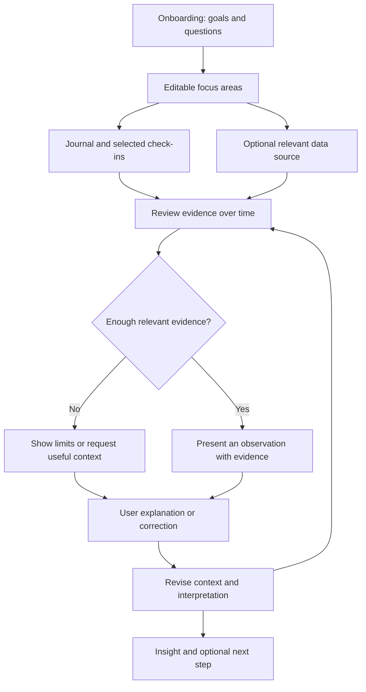
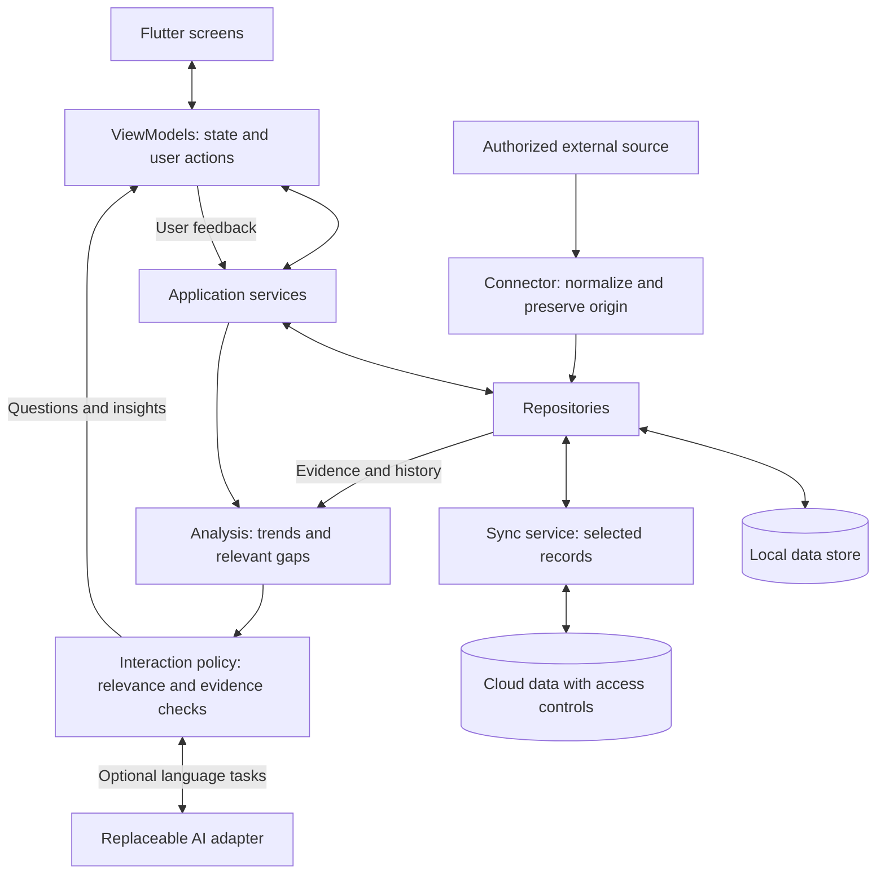

# Personal Insight

**A personal self-understanding app that helps people investigate what matters to them, connect their experiences over time, and reflect on the evidence behind possible patterns.**

Built for **MTM4681 — Mobile Programming, Fall 2026**, using Flutter/Dart. The project is currently in planning; the app has not been scaffolded yet. The name is provisional.

## What we're building

People record different pieces of their lives in different places: thoughts in a journal, commitments in a calendar, and feelings they rarely track consistently. Personal Insight brings relevant pieces together around a question the user actually cares about—such as why their motivation changes, which experiences affect their social energy, or how their priorities have evolved.

The product combines two kinds of exploration: **understanding thoughts and experiences across time**, and **investigating relationships between self-reports and outside context**. Its value comes from helping the user examine a possible explanation, see the supporting evidence, and supply context the app could not know on its own.

### How it works

1. **Start with the user's priorities.** Onboarding establishes their context, goals, and areas they want to understand. A goal such as “improve my grades” differs from a question such as “why does my study motivation fluctuate?” Both help guide the app, and both remain editable.
2. **Capture experience in complementary ways.** Free-form journal entries preserve meaning and context. Brief check-ins—such as social energy, mental energy, or motivation—make it easier to compare experiences over time. Users track dimensions relevant to their own focus.
3. **Add relevant context when useful.** Optional sources, such as a calendar, can help contextualize an observation. Health and location data are possible future sources, not the foundation of the product. The initial version will use a fixed integration, with boundaries that allow additional connectors later.
4. **Investigate rather than assume.** The app identifies a candidate observation or a gap relevant to an active goal, then asks a focused question when clarification could help. The exact method for prioritizing valuable observations remains open.
5. **Refine understanding with the user.** Answers and corrections become part of the context for later reviews. Insights should show what supports them, what remains uncertain, and how the user can challenge them. Optional personal-development suggestions may follow when appropriate.

### A concrete example

A student says improving grades is a priority, but their recent reflections contain nothing about studying. The app could ask:

> “You mentioned that improving your grades matters to you, but your recent reflections haven't discussed studying. Has anything changed, or have you simply been writing about other topics?”

If they respond, “I'm studying normally; I just don't journal about it,” the app should retain that explanation and avoid repeating the same misunderstanding. Missing journal content is a gap in the app's information, not proof that the student stopped studying.

The same principle applies to richer patterns: lower motivation alongside a busy calendar is a possible association to explore, not proof that workload caused it.

## Build approach

### Application structure

The course requires **Flutter/Dart, clean MVVM, navigation, and local + cloud data**. The proposed implementation is one modular application with clear boundaries between presentation, persistence, analysis, and integrations.

| Component | Responsibility |
|---|---|
| **Screens and ViewModels** | Present onboarding, journal/check-ins, review, evidence details, and settings; manage loading, validation, offline, and error states. |
| **Data layer** | Store profiles, goals, reflections, observations, events, hypotheses, and feedback. Preserve timestamps, source identity, and links between derived claims and supporting records. |
| **Analysis** | Produce bounded descriptive observations and candidate questions from relevant history. Keep explicit user statements separate from imported records and AI interpretations. |
| **Interaction policy** | Decide what to present, ask, defer, or suppress. Consider active goals, available evidence, and previous answers; allow correction and dismissal. |
| **AI adapter** | Optionally interpret unstructured text and help phrase questions/explanations. It must work within the available evidence and must not be the sole authority on what is true. |
| **Connectors and sync** | Import authorized context through a common representation and synchronize a defined subset of records with ownership and failure handling. |

### Data and deployment

**Proposed baseline:** local storage and basic analysis on the phone, with a bounded cloud-sync feature aligned with the course. Journaling and check-ins should remain usable offline. Firebase Auth/Firestore is the proposed cloud option; the precise sync scope and conflict policy still need a decision.

Cloud synchronization and cloud AI inference are separate choices. Syncing a record does not automatically authorize sending it to a model. The AI interface should allow us to compare on-device, cloud, and hybrid approaches without rewriting the rest of the app. A transparent template-based question flow is a possible semester fallback if live AI is not feasible.

Start with limited history retrieval by goal, date, and source, and a small number of explainable analysis rules. Graph databases, broad automated correlation searches, and complex backend services are outside the proposed baseline. We will add complexity only when a concrete product need justifies it.

### Decisions still open

- Local database and Provider versus Riverpod for state management.
- First external source, rating scales, and check-in frequency.
- Which records sync, and how conflicts, deletion, and retention work.
- How observations are ranked for personal value, when analysis runs, and which history it retrieves.
- Whether generative AI belongs in the semester build, where it runs, and which model is feasible.

## Semester scope

The proposed MVP demonstrates one complete reflection loop:

| Feature | Minimum outcome |
|---|---|
| Onboarding and profile | Set and update a goal, an inquiry, and selected focus areas. |
| Journal and check-ins | Record, edit, and retrieve personal inputs offline. |
| One fixed context source | Import bounded context, preserve provenance, and handle unavailable access. |
| Evidence-linked review | Show simple trends and relevant observations with supporting records. |
| Questions and feedback | Save explanations/corrections and use them in subsequent reviews. |
| Controlled cloud sync | Demonstrate authenticated local/online data handling and account isolation. |

The semester build excludes a plugin marketplace, multiple health/location integrations, personality or medical inference, and claims of causal understanding. See [the roadmap](docs/ROADMAP.md) for course milestones and delivery criteria.

## Evidence and privacy principles

- **Make claims proportional to evidence.** An association is not a cause; a scheduled event is not proof of attendance; missing data is not zero.
- **Keep the user in control.** Focus areas can change, connections are optional, and interpretations can be challenged.
- **Make uncertainty visible.** Show the source and period behind an observation, and acknowledge when evidence is insufficient.
- **Respect corrections and deletion.** Later reviews should account for explanations; removing evidence should invalidate dependent claims.
- **Minimize sensitive data.** Define what stays local, what syncs, and what may reach AI services. Use synthetic development/demo data and never commit journals or credentials.

## Development status

Planning and documentation only. Setup and run instructions will be added when the Flutter application is initialized. The architecture and MVP above are the proposed build plan, not implemented capabilities.
